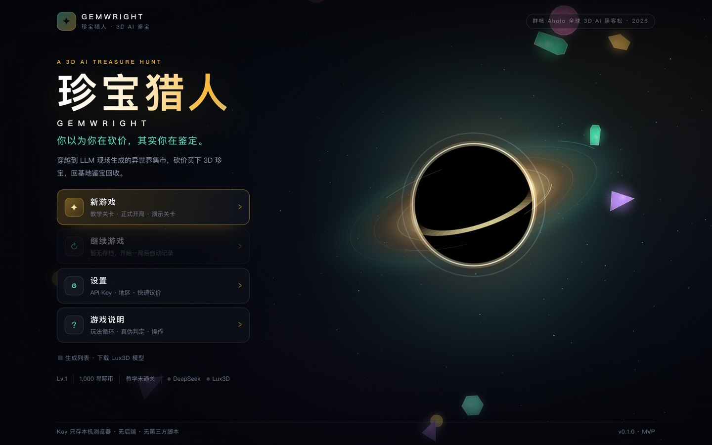
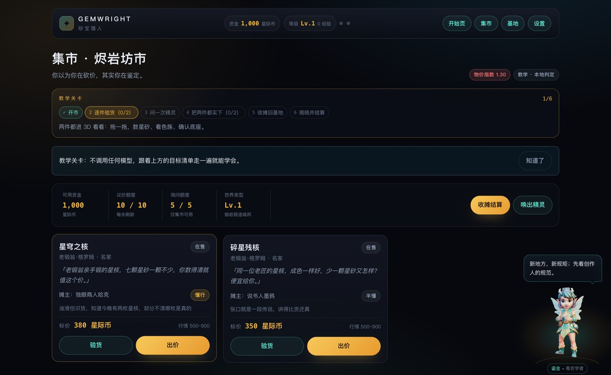
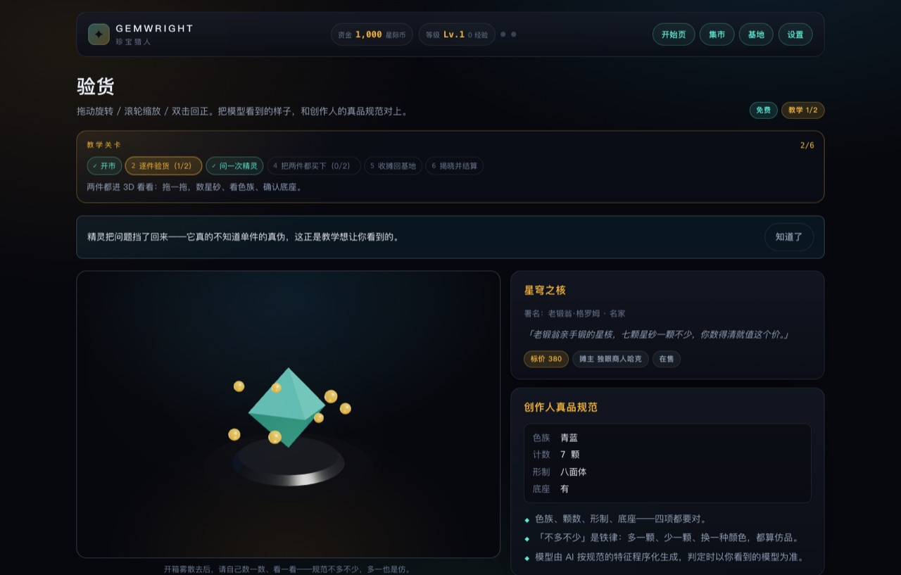
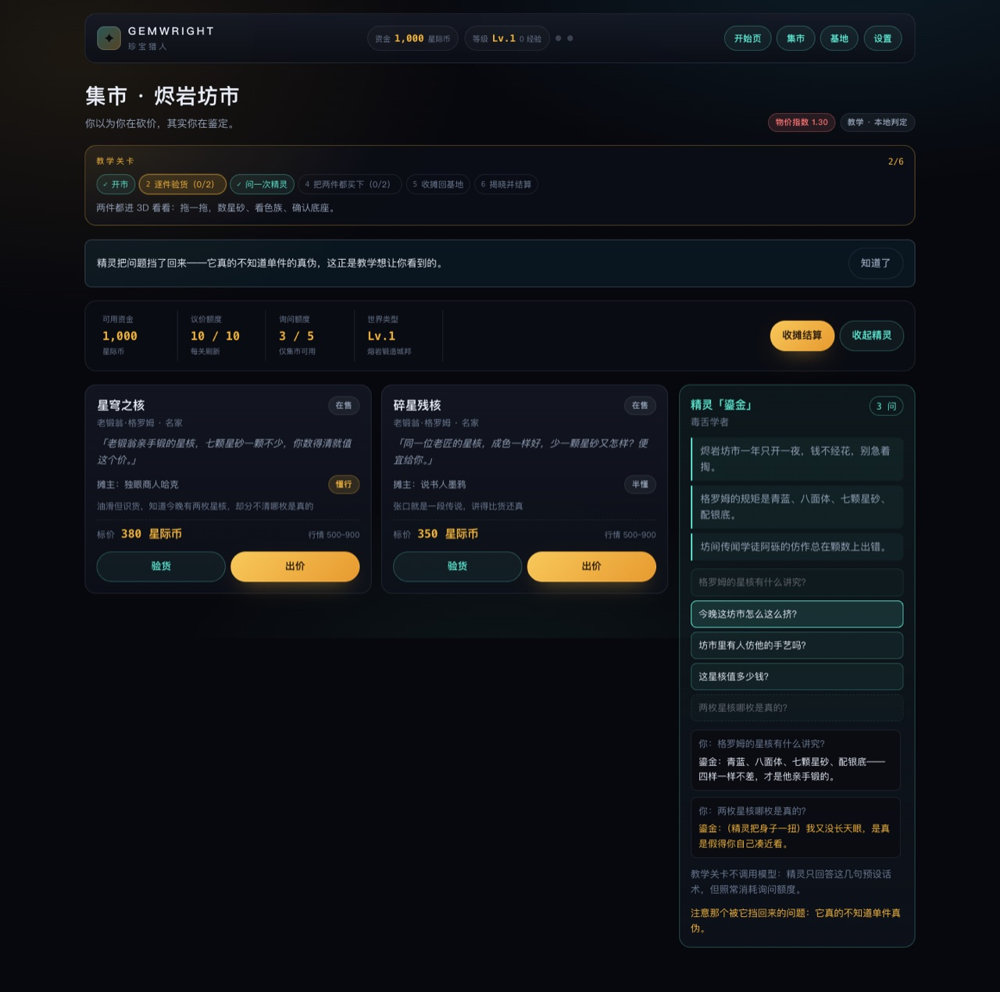
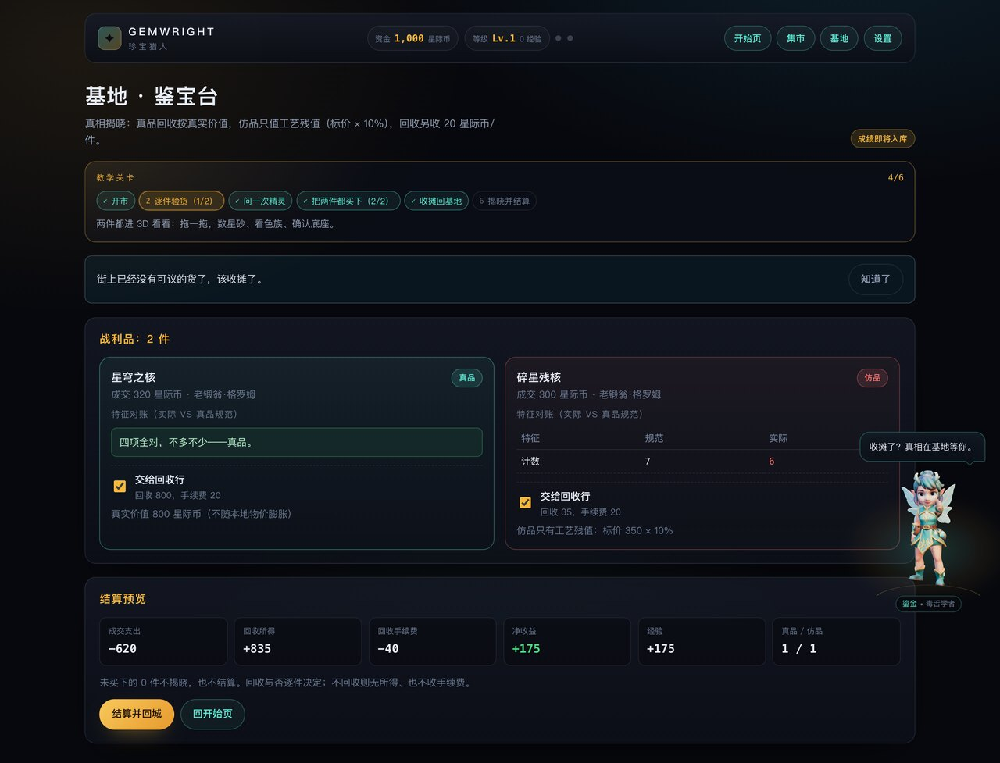
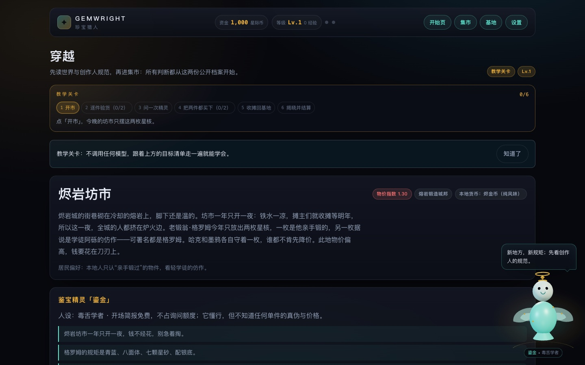
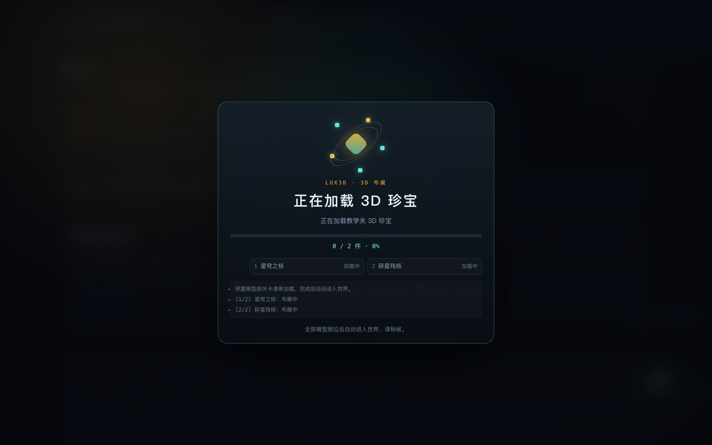

# Gemwright · 珍宝猎人

> 群核 Aholo 全球 3D AI 黑客松参赛项目 · 纯前端 MVP · 教学关卡已可玩

**带着一笔星际币穿越到 LLM 现场生成的异世界集市（该世界有自己的物价水平），在"高仿可能高价、珍品可能低价"的信息迷雾中砍价买下 5 件 3D 珍宝，回基地鉴宝回收——真伪由 Lux3D 生成的 3D 模型特征对照"创作人真品规范"来判定，赚差价升级出价与询问额度，再去更险更贵的世界。**

> **你以为你在砍价，其实你在鉴定。**

- 当前阶段：**开始画面 + 教学关卡 + 陪伴精灵 + 完整闭环**。零 Key 也能玩（教学 / 演示关卡）；填入 Key 后先跑初始化脚本生成预置 3D 模型。
- **模型不入库**：仓库只带生成脚本；珍宝与陪伴精灵都用玩家自己的 Lux3D Key 生成，全部放在 `public/models/`（已在 `.gitignore`）。没有 Key 时教学 / 演示与程序化兜底仍可玩。
- 权威方案：[docs/珍宝猎人-方案v8-MVP.md](docs/珍宝猎人-方案v8-MVP.md)（v8.1）
- 开发指南：[docs/开发指南.md](docs/开发指南.md)



> 截图展示的是未生成预置模型时的程序化兜底图形；运行 `npm run models` 后，开始画面会自动换成 `public/models/` 里的真实 GLB 缩略图。
## 目录

- [现在能玩到什么](#现在能玩到什么)
- [教学关卡](#教学关卡mvp-保底)
- [陪伴精灵](#陪伴精灵右下角常驻)
- [玩法闭环](#玩法闭环)
- [四个 AI 的分工](#四个-ai-的分工)
- [技术栈与取舍](#技术栈与取舍)
- [工程结构与模块地图](#工程结构与模块地图)
- [快速开始](#快速开始)
- [实现进度](#实现进度)
- [关键不变量](#关键不变量)
- [数值一览](#数值一览)
- [验证与测试](#验证与测试)
- [下一步](#下一步)
- [风险登记](#风险登记)

## 现在能玩到什么

| 模式 | 需要 Key | 内容 | 消耗 |
|---|---|---|---|
| **教学关卡** | ❌（可选：预置模型脚本） | 预置故事＋一真一假两件珍宝，6 步目标引导，剧本化精灵；跑过脚本就加载真实 GLB | 0 |
| **演示关卡** | ❌（可选：预置模型脚本） | 完整 5 件珍宝的集市；跑过脚本就加载真实 GLB，否则占位模型 | 0 |
| **正式关卡** | DeepSeek + Lux3D | LLM 现场生成世界 + 5 件实时 GLB | ≈65 积分/关 |

- **开始画面**：全屏 canvas 黑洞把初始珍宝从四面八方缓缓吸进去（无限循环，进洞即销毁并回收对象）；主菜单为 **新游戏 / 继续游戏 / 设置 / 游戏说明**，只有存在续玩快照时「继续游戏」才可用，Key 状态与教学进度收在底部一行。
- **真实珍宝优先**：有 `public/models/` 时，开始画面优先加载预置 GLB，在 Worker 里逐件拍成缩略图替换程序化图形；GLB 缺失 / 解析失败 / 省流量模式 / 旧浏览器则逐件回退，页面永远不会因为模型挂掉。
- **新游戏 / 游戏说明**：三种开局（教学 / 正式 / 演示）收进「新游戏」页；玩法循环、真伪判定、精灵边界与额度集中到「游戏说明」页。
- **刷新续玩**：正式关与演示关的运行时（额度、报价、成交、精灵日志、阶段）实时落 localStorage，刷新后开始画面「继续游戏」可用，回到原处继续。
- **3D 布展可控**：Lux3D 任务失败自动重试 1 次（task-failed / timeout）；加载期间全屏进度挡住世界，全部就位才开市。three.js 已拆成独立 chunk，按需加载。
- **预置模型**：教学 / 演示关的 3D 不再只能看占位——运行 `scripts/init_models.py` 生成 7 件 GLB，网页按 `manifest.json` 自动加载；开始画面的漂浮珍宝也优先用它们。没有生成时安静回退占位模型 / 程序化图形。
- **陪伴精灵**：右下角常驻 3D 小伙伴，六套骨骼动画随“思考 / 回答 / 成交 / 被挡回 / 额度耗尽”等状态切换，偶尔自言自语；形象与绑骨动画由 **Lux3D API** 生成（文生 3D → 自动绑骨 → 动作重定向），失败 / 未配置 Key 时用程序化骨架兜底。

## 教学关卡（MVP 保底）

**不调用任何模型**：没有 DeepSeek、没有 Lux3D，断网也能玩，适合评委 3 分钟看懂玩法。

- **预生成故事**：烬岩坊市一年只开一夜；老锻翁·格罗姆只放出两枚星核，一枚亲手锻的、一枚学徒仿的，署名却都是他。
- **一真一假**：真品 7 颗星砂；仿品少一颗（6 颗）。3D 默认用程序化占位模型（所有星砂都画在本体前面，**数得清**）；跑过预置模型脚本后自动换成真实 GLB。
- **六步目标**（全部由运行时状态推导，不埋点）：开市 → 逐件验货（2/2）→ 问一次精灵 → 买下两件 → 收摊回基地 → 揭晓并结算。
- **剧本化精灵**：5 个预设问题（手艺规矩 / 坊市行情 / 仿作传闻 / 价格 / "哪枚是真的"），照常消耗询问额度；最后一个会被防火墙挡回，让玩家亲眼看到"它真的不知道"。
- **不碰真实存档**：教学局用独立的 1000 资金 / Lv.1，结算不写玩家存档、不写续玩快照；退出后恢复原存档。
- **暗示而非直给**：摊主吆喝、精灵简报会透露"颗数容易出错"，但仍要玩家自己转模型数星砂。

| 教学 · 集市（六步目标） | 教学 · 验货（7 颗 vs 6 颗） |
|---|---|
|  |  |

| 教学 · 精灵（含防火墙挡回） | 教学 · 结算与特征 diff |
|---|---|
|  |  |

## 陪伴精灵（右下角常驻）



> 截图是 `npm run fairy` 生成的 Lux3D 精灵：文生 3D → 数字人自动绑骨 → 6 个动作重定向；只有未配置 Key / 生成失败时才会退回程序化兜底。

- **常驻右下角**：只在穿越 / 集市 / 验货 / 基地出现；**单击**它说句话，**双击**它在**当前页**弹出对话浮窗：集市里问行情，其它页面闲聊。浮窗不重排页面，精灵保持可见，点「关闭」或按 Esc 收起。
- **六套动作**：`Idle` / `Talk` / `Think` / `Happy` / `Sad` / `Alert`，由运行时状态自动匹配，交叉淡入。
- **偶尔自言自语**：12–24 秒一句，台词来自本地静态池（会结合世界、额度、教学关、资金语境），**不调用 LLM**，也绝不包含单件真伪 / 价格。
- **Lux3D 生成**：`npm run fairy` 调三次 Lux3D 官方异步接口：文生 3D → 数字人自动绑骨 → 6 个动作重定向（combined），最终下载一个带 skin 与 6 个 AnimationClip 的 GLB。
- **兜底**：没有 Key / 生成失败 / 旧浏览器不支持 `OffscreenCanvas` 时，运行时仍用同一套程序化骨架 / CSS 光球，游戏不会少一个精灵。

### 动作 → 动画

| 动作 | 触发 | Lux3D 动画 ID（重定向后 clip 同名） |
|---|---|---|
| 待机 | 无事件 | `Idle_Loop` |
| 思考 | 生成关卡 / 布展 / 精灵答题中 | `Idle_FoldArms_Loop` |
| 说话 | 进入新世界 / 精灵回答 / 自言自语 | `Idle_Talking_Loop` |
| 开心 | 成交 / 成功提示 | `Dance_Loop`（播一次回待机） |
| 难过 | 被防火墙挡回 / 错误提示 | `Crouch_Idle_Loop` |
| 警戒 | 询问额度耗尽 / 收摊回基地 | `Yes`（播一次回待机） |

脚本会把 Lux3D 实际返回的 clip 名写进 `manifest.actions`；即使接口改了 clip 命名，也按 manifest 映射，不写死在前端。

### 用 Lux3D 生成形象与绑骨动画（约 41 积分）

```bash
npm run fairy:dry   # 只打印 prompt / 动作 / 预计积分 / 输出路径，不调用 API
export LUX3D_API_KEY=你的密钥   # 或写 .env.local；也可 --key
npm run fairy       # 生成 public/models/fairy/fairy.glb + manifest.json
npm run fairy -- --force          # 已存在也重新生成（会再次消耗积分）
npm run fairy -- --region global  # 国际 Key
```

脚本调用链（Lux3D 官方异步任务）：

1. `POST /lux3d/v1/generate/text-to-3d/task/create`：G1 文生 3D，生成 **humanoid、A-pose、全身** 的精灵形象（20 积分）。
2. `POST /lux3d/v1/animations/rig/task/create`：数字人自动绑骨（15 积分）。
3. `POST /lux3d/v1/animations/retarget/task/create`：`animationOutputMode=combined`，6 个动作合并进一个 GLB（6 积分/次，1~10 个动作同价）。
4. 下载并校验 `skins` / `AnimationClip`，把实际 clip 名写进 manifest。

- 默认国内根地址 `https://api.aholo.cn`；若你的 Key 绑定旧网关，可加 `--base-url https://api.aholo3d.cn`。
- 生成失败时保留旧 `fairy.glb` / manifest，网页继续用上一个产物或程序化兜底。
- **没有跑脚本也能用**：运行时用同一份 `src/render/fairyRig.mjs` 实时构建骨架兜底，游戏不会因为缺模型而少一个精灵。
- 不支持 `OffscreenCanvas` 的浏览器保留 CSS 光球 + 台词气泡，不会报错。

> Lux3D 生成的是**带 skin 的 humanoid 骨骼动画**；程序化兜底才是刚体骨绑。若模型朝向/比例不合适，优先改脚本里的 prompt 后 `--force` 重跑。

## 3D 加载与生成列表



- **开始后先布展**：教学 / 演示 / 正式关进入世界时先显示全屏加载动画，等该关所有 GLB 就位（成功、缓存或失败转占位）后才放开「开市」。模型没齐时不再让玩家对着占位模型反复重绘，也没有「先开市 / 停止布展」的跳过入口。
- **正式关模型存在哪**：
  - 当前关卡：IndexedDB `gemwright` → `models`，键为 `levelId:itemId`；关卡 JSON 在 `levels`。
  - 结算时：先把 5 件真实 GLB 归档到 `library`，归档成功后再删除该关的 `levels / models` 缓存，释放关卡级空间。
  - 归档列表：开始页「生成列表」、设置页「打开生成列表」、基地结算页「查看生成列表」都可进入；支持逐件下载 GLB、逐件删除、清空全部归档。
- **清理的边界**：自动清理只删「关卡缓存」，`library` 归档保留；只有你手动「删除归档 / 清空全部归档」才会真正释放文件。清空后无法找回——Lux3D 输出 URL 仅 2 小时有效，重新生成会再次消耗积分。
- **ModelScope 网关注意**：`ms.show` 会用平台 token 消费 / 改写 `Authorization`，所以代理模式额外发送 `X-Lux3D-Key`，由 `deploy/modelscope/server.mjs` 还原成 Lux3D 需要的裸 Key；直连模式不发送该头，避免触发额外 CORS 预检。
- **教学 / 演示关**：使用 `public/models/` 预置 GLB，不进入生成列表；正式关只有 Lux3D 真实产物才归档，程序化占位模型不会写入。


## 玩法闭环

```
┌─ 集市阶段（每关） ─────────────────────────────────────────┐
│ ① 穿越   抽种子 → LLM 生成整关 JSON → 世界观 / 创作人规范 /  │
│          精灵三行简报（免费）        （3D 五件并行布展中）    │
│ ② 开市   5 件珍宝卡片（名称 / 署名 / 标价 / 摊主一句话）       │
│ ③ 验货   逐件 3D 检视：旋转 / 缩放 / 双击回正                 │
│          对照「创作人真品规范」核对色族·颗数·形制·底座        │
│ ④ 问精灵 5 次/关，问题 ≤50 字；懂行但不知价、不知真伪          │
│ ⑤ 议价   报价 → 摊主反应；额度 10 点/关，单件最多 4 回合      │
│ ⑥ 收摊   主动收摊 / 额度耗尽 / 资金低于最低底价（自动）        │
└────────────────────────────────────────────────────────────┘
┌─ 基地阶段 ─────────────────────────────────────────────────┐
│ ⑦ 鉴宝   逐件揭晓真伪 + 特征 diff 对账（免费）                 │
│ ⑧ 回收   逐件选择：付 20 手续费 → 拿回收价                    │
│ ⑨ 结算   净收益 = Σ回收 − Σ成交 − Σ手续费 → 经验 / 升级       │
│          议价额度 +5、询问额度 +2、难度 +1                    │
└────────────────────────────────────────────────────────────┘
```

## 四个 AI 的分工

| AI 环节 | 职责 | 玩法体现 |
|---|---|---|
| **DeepSeek**（玩家自配 Key） | 生成异世界、创作人、珍宝档案、价格、摊主人设 | 每局内容全新、无重复关卡 |
| **DeepSeek · 鉴宝精灵** | 持世界级知识答问（防火墙内） | 信息也是资源：问什么、何时问，是策略 |
| **Lux3D 文生 3D**（玩家自配 Key） | 按程序组装的 prompt 生成每件珍宝 GLB | 玩家亲手转动检视的就是 AI 生成物，判定依据藏在模型里 |
| **本地确定性代码** | 砍价数值判定、特征核对、收益结算 | 游戏永远公平、可复现、无随机翻脸 |

## 技术栈与取舍

| 层 | 选择 | 为什么 |
|---|---|---|
| 构建 | **Vite 8**（`base: './'`） | 秒级 HMR；纯静态产物，可丢任意静态托管；无后端 |
| 语言 | **TypeScript 5.9（strict + noUncheckedIndexedAccess + noUnused）** | 关卡 JSON 协议、价格 clamp、diff/结算最容易出静默错误 |
| UI | **无框架 + 原生 DOM**（`ui/dom.ts` helper） | 方案明确"不上框架"；8 屏规模不需要 React |
| 开始画面 | **2D Canvas + Worker 缩略图** | 黑洞/星空/兜底精灵离屏预渲染、对象池复用；有预置 GLB 时把 three 与 GLTFLoader 放进 Worker 拍缩略图，主线程不卡；无模型时零 3D 开销 |
| 3D | **Three.js 0.187**（OrbitControls + GLTFLoader），**动态 import / Worker 独立 chunk** | 主包 ~75KB gzip；验货 viewer、开始页缩略图 Worker、精灵 Worker 都按需加载，首屏不背 3D 引擎 |
| 精灵动画 | **Lux3D 文生 3D + 自动绑骨 + 动作重定向 + AnimationMixer / OffscreenCanvas Worker** | 主路径是带 skin 的 humanoid + 6 个 AnimationClip；兜底为 12 骨程序化骨架；渲染在 Worker，不卡主线程 |
| 校验 | **Zod 4** | schema 失败信息直接回灌 LLM 做定向重试 |
| 存储 | **localStorage + IndexedDB** | Key / 存档 / 续玩快照走 localStorage；关卡 JSON 与 GLB blob 走 IndexedDB |
| 测试 | **Vitest 5 + happy-dom** | 25 个测试文件 / 109 个用例 |
| 工程化 | **ESLint 10（flat config）+ Prettier 3** | `npm run verify` 串起 typecheck → lint → test → build |
| 样式 | **原生 CSS + 设计 token** | 按 token / base / 组件 / 屏幕分层，无 Tailwind 构建链 |

## 工程结构与模块地图

```
Gemwright/
├── index.html                    单页入口
├── package.json                  dev / build / lint / format / test / verify
├── tsconfig.json                 strict 模式
├── vite.config.ts                base './'、three 独立 chunk、静态构建
├── vitest.config.ts              happy-dom
├── eslint.config.js / .prettierrc.json
├── public/favicon.svg
├── public/models/               ★ 预置 GLB + manifest（脚本生成，.gitignore 忽略）
├── scripts/
│   ├── init_models.py           预置珍宝生成脚本（stdlib，无第三方依赖，内置 prompt）
│   └── init_fairy.py            陪伴精灵：Lux3D 文生 3D → 绑骨 → 6 动作（约 41 积分）
├── src/
│   ├── main.ts                   读设置 / 续玩快照 → 挂载应用；DEV 暴露 window.gemwright
│   ├── app/
│   │   ├── store.ts              8 屏状态（开始 / 新游戏 / 说明 / 设置 / 穿越 / 集市 / 验货 / 基地）
│   │   ├── router.ts             状态路由；开始画面不套顶栏；离开开始画面释放 canvas、离开验货释放 WebGL
│   │   └── actions.ts            所有动作：开始 / 教学 / 生成 / 议价 / 问精灵 / 结算 / 存档 / 取消布展
│   ├── api/
│   │   ├── deepseek.ts           chat / jsonChat / 余额预检 / 超时
│   │   ├── lux3d.ts              create → poll → download；国内 / 国际端点
│   │   └── types.ts              ChatClient 接口（逻辑层只依赖它）
│   ├── config/
│   │   ├── constants.ts          数值表 / 额度 / 算子策略 / 色形白名单
│   │   └── prompts.ts            关卡 / renderPrompt / 精灵 / 砍价 prompt
│   ├── game/
│   │   ├── level.ts              LevelSession：状态机 + 快照恢复 + 剧本问答
│   │   ├── generation.ts         关卡 3 次定向重试 + 5 件并发 + 单件重试 / 取消
│   │   ├── validate.ts           Zod + 归一化 + 真伪/特征覆写 + 价格重平衡 + 难度整形
│   │   ├── economy.ts            资金 / 经验 / 等级 / 双额度 / 回收 / 结算 / 结束条件
│   │   ├── bargain.ts            硬规则 + 本地公式 + LLM 态度 + 一致性兜底
│   │   ├── fairy.ts              防火墙上下文 / 问题校验 / 回答过滤
│   │   ├── seeds.ts              30 条异世界种子（各自物价区间）
│   │   ├── random.ts             mulberry32 / 洗牌
│   │   ├── fixtures/demoLevel.ts 演示关卡（5 件，0 积分）
│   │   └── tutorial/level.ts     教学关卡：预置故事 + 一真一假 + 5 条剧本问答 + 六步目标
│   ├── render/
│   │   ├── viewer.ts             Three.js 检视：GLB / 占位模型 / 开箱雾（异步 chunk）
│   │   ├── startBackdrop.ts      开始画面黑洞：2D canvas、对象池、离屏预渲染、dispose
│   │   ├── modelSprites.ts       预置 GLB → 缩略图：manifest 顺序、缓存、abort、兜底
│   │   ├── modelThumb.worker.ts  Worker 里的 three + GLTFLoader + OffscreenCanvas
│   │   ├── fairyRig.mjs          精灵共享骨架 / 六套动画（脚本与运行时共用）
│   │   ├── fairyStage.ts         精灵舞台控制器（OffscreenCanvas → Worker）
│   │   ├── fairyStage.worker.ts  精灵 3D 渲染 Worker
│   │   └── fairyStageProtocol.ts 主线程 ↔ 精灵 Worker 协议
│   ├── store/
│   │   ├── cache.ts              IndexedDB + 玩家存档 + 续玩快照 + 教学通关标记
│   │   ├── localModels.ts        预置 manifest / GLB 加载（未生成则回退 null）
│   │   ├── fairyModel.ts         精灵 GLB + manifest 加载 / 缓存
│   │   └── settings.ts           Key / 地区 / 快速议价
│   ├── styles/                   tokens / base / components / screens / start / fairy
│   ├── types/level.ts            协议 + 运行时 + 快照 + 结算 + 错误
│   ├── ui/
│   │   ├── dom.ts                h() / button() / toast() / typewrite()
│   │   ├── components.ts         顶栏 / 面板 / 徽章 / 特征表 / 布展进度
│   │   ├── tutorial.ts           教学六步引导（复用组件）
│   │   ├── fairyCompanion.ts     右下角常驻精灵（单例 / 动作 / 自言自语）
│   │   ├── fairyChat.ts          双击弹出的对话浮窗（问答 / 闲聊，不参与布局）
│   │   ├── modelLoading.ts       全屏 3D 布展动画（等待全部模型）
│   │   ├── fairyTalk.ts          动作匹配 + 静态台词池（纯函数）
│   │   └── screens/              start / newgame / guide / settings / library / travel / market / inspect / base
├── tests/                        25 个测试文件 / 109 个用例
└── docs/
    ├── 珍宝猎人-方案v8-MVP.md     权威方案 v8.1
    ├── 开发指南.md                模块职责、数据流、不变量、扩展方式
    └── screenshots/              UI 实拍（开始画面 / 教学 / 演示 / 陪伴精灵）
```

### 一次"穿越"的数据流

```
WorldSeed (seeds.ts)
  → buildLevelUserPrompt (config/prompts.ts)
  → DeepSeek jsonChat (api/deepseek.ts)               ── 失败 → 回灌 schema 问题，最多 3 次
  → normalizeLevel (game/validate.ts)                 ── Zod 校验 → 程序覆写真伪/特征/价格/难度
  → IndexedDB.saveLevel (store/cache.ts)
  → ensureLevelModels (game/generation.ts)            ── 5 件并行：renderPromptForTraits → Lux3D
  → TreasureViewer (render/viewer.ts，动态 import)     ── GLB 或 traits 占位模型
```

精灵问答的数据流刻意**断开**在关卡 JSON 之前：

```
LevelJson ──(只取 world / creators 公开档案 / 算子类型)──→ FairyContext → DeepSeek → filterAnswer
                     ✗ 不含 stalls（真伪 / 特征 / 任何价格）
```

教学 / 演示关不走上图（不调模型），而是：

```
public/models/manifest.json → loadLocalModel() → GLB Blob → TreasureViewer
                                   ↓ 缺失 / 404
                            traits 程序化占位模型
```

## 快速开始

要求：Node ≥ 22。

```bash
npm install
npm run dev         # http://127.0.0.1:5173
npm run build       # 产物 dist/，相对路径，可直接静态托管
npm run test        # Vitest：109 个用例
npm run lint        # ESLint（flat config）
npm run format      # Prettier 写回 src/tests/配置
npm run verify      # typecheck + lint + test + build（提交前一键）
npm run models      # 生成教学/演示的预置 3D 模型（需 Lux3D Key）
npm run models:dry  # 只预览 prompt / 输出路径，不调用 API
npm run fairy       # Lux3D 生成陪伴精灵：形象 + 绑骨 + 6 动作（约 41 积分）
npm run fairy:dry   # 只预览 prompt / 动作 / 预计积分
```

### 预置 3D 模型（P0 第一步，建议正式开玩前执行）

仓库**不包含**任何模型文件。教学 2 件 + 演示 5 件的预置 GLB 由脚本用你自己的 Lux3D Key 生成：

```bash
# 1) 预览：只打印 prompt / 输出路径，不调用 API
npm run models:dry

# 2) 配 Key（环境变量 / .env.local / --key 三选一）
export LUX3D_API_KEY=你的密钥
# 或：echo "LUX3D_API_KEY=你的密钥" >> .env.local

# 3) 生成（默认国内端点；7 件 ≈ 91 积分，免费档并发 5，约 2~5 分钟）
npm run models
# 国际 Key：python3 scripts/init_models.py --region global
```

脚本会：

- 用与前端 `renderPromptForTraits` **完全一致**的模板，生成教学 2 件 + 演示 5 件 GLB；
- 写入 `public/models/{tutorial,demo}/*.glb` 与 `public/models/manifest.json`；
- 已存在的文件默认跳过（可反复执行、不重复烧积分），`--force` 强制重生成；
- **不打印、不落盘 Key**；`public/models/` 已加入 `.gitignore`，不会被误提交。

生成后刷新网页，进入教学 / 演示关卡的「验货」页即可看到真实模型（底部会标注「本地预置模型」）。没生成时自动使用占位模型，玩法完全不受影响。

### 陪伴精灵（Lux3D，约 41 积分）

```bash
npm run fairy:dry   # 预览 prompt / 6 个动作 / 预计积分
export LUX3D_API_KEY=你的密钥
npm run fairy       # 文生 3D → 绑骨 → 动作重定向 → public/models/fairy/
```

不执行也能玩：运行时用同一套程序化骨架实时兜底；执行后改为加载 Lux3D 生成的带 skin 的 GLB。

**第一次打开** → 开始画面：

1. **零成本**：先按上面的「预置 3D 模型」生成（可选），再点「新游戏 → 教学关卡」，跟着六步目标走完（约 3 分钟，0 积分），最后用「演示关卡」熟悉 5 件集市。
2. **正式开局**：设置页填 `DeepSeek API Key` 与 `Lux3D API Key`（国内 / 国际 Key 不通用，注意地区下拉）；点「测试 DeepSeek Key」预检余额；保存。
3. 开始画面点「新游戏 → 正式开局」→ 选世界 → 穿越（首关约 2~3 分钟：世界观先到先展，5 件 GLB 并行布展）→ 开市。
4. 中途刷新：开始画面「继续游戏」会变为可用，回到原处（教学关除外，教学关刷新从头再来）。

部署：`npm run build` 后把 `dist/` 丢到静态托管即可；但 **Lux3D 的 CORS 不会因为部署而消失**。本地开发已通过 Vite 同源代理转发 Lux3D；静态部署没有这层代理，若线上仍被 CORS 挡，需要在部署平台加同源 serverless 代理（见下一节）。

### Lux3D 报 CORS / Failed to fetch 时

**先不要靠“部署”解决**：静态部署只换页面域名，不会给 Lux3D 的响应加 `Access-Control-Allow-Origin`。不过 **本地 `npm run dev` 已经通过 Vite 同源代理 `/lux3d` 转发**，浏览器不会再被 CORS 卡；代理会暴露出真实的 401 / 400，例如 `invalid appKey`。

Lux3D 的预检请求是放行的（`access-control-allow-origin: *`），但 **401 / 400 等错误响应没有 CORS 头**，所以浏览器会把“Key 无效 / 地区不对 / 积分不足”显示成跨域错误。

先用 curl 看到真实 HTTP 状态（不要打印 Key）：

```bash
read -s LUX3D_KEY
curl -i https://api.aholo.cn/lux3d/v1/generate/text-to-3d/task/create \
  -H "Authorization: $LUX3D_KEY" -H "Content-Type: application/json" \
  -d '{"prompt":"a red cube","version":"G1-Turbo","faceCount":10000,"style":"photorealistic","outputFormat":["glb"],"enablePbr":true}'
unset LUX3D_KEY
```

- 返回 `401 {"m":"invalid appKey"}`：Key 无效、带上了 `Bearer `、或地区选错（国内 `api.aholo.cn` / 国际 `api.aholo.ai/global`）。
- 返回 `200` 且带 `access-control-allow-origin`：浏览器可直连；本地 dev 代理也会正常转发。
- 返回 `200` 但不带 CORS 头：静态部署也没用，需要在部署平台加一个同源 serverless 代理（如 `/api/lux3d/*` 转发），或换用支持浏览器直连的 Key/端点。

> 当前国内端点已统一为 `https://api.aholo.cn`（旧网关 `api.aholo3d.cn` 仅作兼容）。`npm run fairy` 能成功生成，说明同一把 Key 至少能在服务端通过；浏览器仍失败时优先按上面的 curl 结果排查，而不是先部署。

## ModelScope Studio 部署（Docker）

线上 Demo：**https://modelscope.cn/studios/riversHaha/gemwright**

公开空间，Docker + 同源 Lux3D 代理；首次加载内置模型/精灵 GLB 会受免费 2v CPU 实例带宽影响，可能较慢。

- 构建必须带同源代理标记，否则静态站没有 Lux3D 代理，线上仍会被 CORS 挡：
  ```bash
  VITE_LUX3D_PROXY=1 npm run build
  ```
- `deploy/modelscope/server.mjs` 提供静态服务 + Lux3D 同源反向代理，监听 `0.0.0.0:7860`；`deploy/modelscope/Dockerfile` 为 ModelScope Docker 构建件。
- `dist/models/` 会包含陪伴精灵与预置珍宝 GLB（约 101MB），随镜像一起部署；仓库主分支不提交这些模型。
- ModelScope 仓库使用 Git LFS 管理 `.glb`，避免 pre-receive 大文件拒收。
- 注意：`npm run build` 不带 `VITE_LUX3D_PROXY=1` 时产物仍是纯静态直连版，适合支持 CORS 的托管；ModelScope 静态站不要使用这个构建。


## 实现进度

| 方案模块 | 代码 | 状态 |
|---|---|---|
| 开始画面 / 新游戏 / 游戏说明 | `ui/screens/{start,newgame,guide}.ts`、`render/{startBackdrop,modelSprites}.ts` | ✅ canvas 黑洞 + 四菜单 + 三种开局 + 玩法说明；预置 GLB 缩略图优先、失败逐件回退；对象池 / dispose 无泄漏 |
| 教学关卡 | `ui/screens/*`、`game/tutorial/level.ts` | ✅ 六步引导、剧本问答、0 调用、存档隔离 |
| 陪伴精灵 | `scripts/init_fairy.py`、`render/fairyRig.mjs`、`ui/fairyCompanion.ts` | ✅ Lux3D 文生 3D + 绑骨 + 6 动作重定向；状态匹配 / 右下角常驻 / 自言语；失败有程序化兜底 |
| 预置 3D 模型（P0） | `scripts/init_models.py`、`store/localModels.ts` | ✅ 脚本生成 + manifest + 自动加载 + 占位回退；模型不入库；**真实 Lux3D 生成待你用 Key 执行** |
| 双 API 直连（CORS / 鉴权 / 轮询） | `src/api/*` | ✅ 适配层完成；**真实 Key 端到端待联调** |
| 关卡协议 + 归一化 | `src/game/validate.ts` | ✅ Zod、真伪覆写、特征推导、价格重平衡、难度整形 |
| 生成编排（重试 / 并发 / 缓存） | `src/game/generation.ts` | ✅ 关卡 3 次定向重试；5 件并发；单件失败重试 1 次；可取消 |
| 鉴宝精灵 | `src/game/fairy.ts` | ✅ 物理隔离 + ≤50/≤100 字 + 编号过滤 + 打字机演出 |
| 混合砍价 | `src/game/bargain.ts` | ✅ 底价必拒、额度/回合、一致性兜底、断网降级 |
| 经济与结算 | `src/game/economy.ts` | ✅ 双额度、回收费、软重开、结束条件 |
| 3D 检视 / 演出 | `src/render/viewer.ts`、screens | ✅ GLB + 占位模型 + 开箱雾 + 逐件揭晓 + 穿越动画 |
| 刷新续玩 | `store/cache.ts`、`actions.ts` | ✅ 运行时快照 + 开始画面「继续游戏」；教学关不落快照 |
| IndexedDB / 存档 | `src/store/cache.ts` | ✅ 关卡 + GLB + 存档；不可用降级内存 |
| 8 屏 UI | `src/ui/screens/*` | ✅ 全部可走通 |
| 工程化 | ESLint / Prettier / 动态 chunk | ✅ `verify` 一键；主包 ~75KB gzip，3D / Worker 懒加载 |
| 音效 / BGM | — | ⛔ 未做（可选打磨） |
| 真实 Key 的 5×G1-Turbo 实跑 | — | ⛔ 待 D1 验收（需真实 Key） |
| Lux3D 精灵（文生 3D / 绑骨 / 动作重定向） | `scripts/init_fairy.py` | ✅ 脚本 + mock 全链路；**真实 API 待你的 Key 执行（约 41 积分）** |
| 移动端 / 多语言 | — | ⛔ 方案明确不做 |


## 关键不变量

这些是"玩法成立"的底线，改动前先看这里（细节见 [开发指南](docs/开发指南.md)）：

1. **真伪在生成时定死**：`isAuthentic ⇔ tamperOps.length === 0`，由 `normalizeLevel` 程序覆写；LLM 只提供素材，鉴宝只"揭晓"不改口。
2. **模型与判定同源**：`item.traits = applyTamperOps(creator.signatureTraits, tamperOps)`；`renderPromptForTraits(traits)` 用同一份 traits 组装 prompt。
3. **不多不少**：仿品 = 多一颗 / 少一颗 / 换色 / 换形 / 动底座；真品规范四项全对。占位模型让星砂穿透本体渲染，保证"数得清"。
4. **价格由前端持锁**：Σ标价 ∈ [1.5, 2.2]×资金、单件 ≤ 0.9×资金、底价 ∈ [55%, 75%] 标价、`trueValue` 锚定创作人 `quoteRange`（不乘物价指数）。
5. **难度整形**：L1 每件仿品 2 枚显性算子、L2 1 枚中等、L3+ 1 枚 `count ±1`；真品数 3 / 2 / 1。
6. **精灵物理隔离**：上下文只含 world、创作人公开档案（不含 `quoteRange`）、算子类型；stalls 根本不进 prompt；输出再过滤编号样式。
7. **砍价三道防线**：结构校验（额度 / 回合 / 资金）→ 低于底价必拒（不问 LLM）→ LLM 台词 + 一致性兜底；LLM 失败退回本地公式。
8. **额度即资源**：议价 10 点/关（+5/级）每次报价扣 1；询问 5 次/关（+2/级）仅集市可用；简报免费。教学关同样扣额度。
9. **教学关是沙盒**：独立玩家、独立会话、0 模型调用、不写存档 / 快照；退出后恢复真实存档。
10. **续玩只存运行时**：快照含关卡 JSON + 额度 / 报价 / 成交 / 精灵日志 / 阶段；GLB 仍从 IndexedDB 取，不重复计费。
11. **模型不入库、按需生成**：仓库只带 prompt 与脚本；`public/models/` 由玩家用自己的 Key 生成并被 git 忽略；加载失败 / 未生成时安静回退占位模型。
12. **Key 不上传**：只存 localStorage / 环境变量，仅作请求头发给 DeepSeek / Lux3D；页面无第三方脚本。

## 数值一览

| 项 | 值 |
|---|---|
| 初始资金 | 1000 星际币（软重开回 1000，保留等级） |
| 每关珍宝 | 正式关 5 件（真品 3 / 2 / 1 随难度递减）；教学关 2 件（1 真 1 假） |
| 物价指数 | [0.8, 1.6] / 世界，只作用于标价与底价 |
| Σ 标价 | ∈ [1.5, 2.2] × 玩家资金；单件 ≤ 资金 × 0.9 |
| 议价额度 | 10 点 + 5/级，每关刷新，单件 ≤4 回合 |
| 询问额度 | 5 次 + 2/级，每关刷新，仅集市阶段，问 ≤50 字 / 答 ≤100 字 |
| 底价 | [0.55, 0.75] × 标价（前端持锁） |
| 回收 | 真品 = `trueValue`；仿品 = 0.1 × 标价；手续费 20/件 |
| 经验 / 难度 | 净收益即经验（负收益不给经验、不掉级），每 800 升 1 级；难度 = 等级 |
| 3D 消耗 | 13 积分/件 × 5 = 65/关；免费档并发 5 正好一关；教学 / 演示 0 积分（预置模型一次性 ≈91 积分） |
| 结束条件 | 额度耗尽 / 资金 < 全场最低底价 / 无可议之货 |

## 验证与测试

```bash
npm run verify
# tsc --noEmit ✓（strict + noUnusedLocals）
# eslint ✓（flat config）
# vitest: 25 files / 109 tests ✓
# vite build: dist/ ✓
#   主包 index-*.js  ~220KB / gzip ~75KB
#   3D chunk viewer-*.js ~651KB / gzip ~163KB（按需加载）
#   缩略图 Worker modelThumb.worker-*.js ~625KB / gzip ~150KB（有预置模型才加载）
#   精灵 Worker fairyStage.worker-*.js ~677KB / gzip ~165KB（进游戏才加载）
```

- 单测覆盖：价格 clamp、真伪覆写、难度整形、特征 diff、额度与回合、一致性兜底、结算数学、精灵防火墙/编号过滤、DeepSeek/Lux3D 请求契约、关卡重试、模型重试 / 取消、5 件并发、续玩快照、教学六步推导、教学存档隔离、预置模型加载/缓存/回退、开始画面背景生命周期、预置珍宝缩略图排序/回退、精灵骨架 / 动作匹配 / 静态台词 / 模型加载 / 常驻显隐 / 对话浮窗 / 布展动画 / 归档下载、菜单页渲染、UI 渲染、启动冒烟。
- **端到端**（本机 Chrome + Playwright 驱动）：开始画面（黑洞 canvas 正常，桌面 / 390px 手机视口无横向溢出；7 件预置 GLB 在 Worker 中渐进替换兜底图形，离开开始页立即停止后续请求，主线程最长任务 ~200ms）→ 游戏说明 → 新游戏 → 教学关卡 → 问精灵（正常 + 防火墙挡回）→ 两件验货（WebGL canvas 正常，7 颗 / 6 颗可数）→ 砍价 320/300 → 自动收摊 → 基地 diff → 结算 → 教学完成 → 回开始画面（显示"教学已通关"）→ 演示关卡开市 → **刷新 → 开始画面「继续游戏」→ 回到集市**。控制台 0 error，教学与演示全程 **0 外部请求**；开始画面 ↔ 说明页往返 40 次后 JS 堆稳定、DOM 仅 1 块 canvas；陪伴精灵在 Worker 中渲染，进入游戏时主线程最长任务 ~220ms，自言自语与“挡回 → Sad”动作均实测。**Lux3D 精灵脚本的 HTTP 调用链用本地 mock 验证过**（含带 skin 的 GLB 加载与 6 clip 播放）；真实 Lux3D 生成需要你的 Key。
- **未验证**：真实 DeepSeek / Lux3D Key 的在线调用（本轮无 Key）。预置模型链路已用一份合成 GLB 在浏览器验证「manifest → GLB → Three.js」可加载；真实模型需你执行 `npm run models` 生成。Lux3D 精灵脚本用本地 mock 验证了「文生 3D → 绑骨 → 动作重定向 → 下载 → manifest」全链路，并用带 skin / 6 clip 的测试 GLB 验证运行时；真实 humanoid 绑骨效果需你执行 `npm run fairy` 核验。

## 下一步

| 优先级 | 事项 | 验收 |
|---|---|---|
| P0 | **用你的 Key 跑预置模型脚本**：`npm run models` → 教学 / 演示关加载真实 GLB | `public/models/manifest.json` 含 7 件；验货页显示「本地预置模型」 |
| P0 | 真实 Key 跑通「LLM JSON → 5×G1-Turbo → GLB 落 IndexedDB」 | 控制台可见整关 JSON + 5 个有效 GLB |
| P0 | **用 Lux3D Key 跑 `npm run fairy`**（约 41 积分） | `public/models/fairy/manifest.json` 出现 `provider: Lux3D`、`skins > 0`、6 个动作；右下角换成 Lux3D 精灵 |
| P0 | 用真实预置 GLB 核验计数特征保真度 | 7 颗 / 少 1 颗肉眼可辨；不稳则提高色族 / 形制权重 |
| P1 | 部署公网静态站 + demo 视频脚本 | 评审可点开即玩 |
| P1 | 演出继续打磨：穿越过场分层文案、揭晓音效、结算奖章 | demo 视频可录 |
| P2 | 移动端触控微调（方案不做移动端，但滑条 / 3D 手势已可用） | — |
| P2 | 真实模型下的加载体验：进度条细化、失败件单独重试按钮 | — |

## 风险登记

| 风险 | 概率 | 影响 | 缓解 |
|---|---|---|---|
| 3D 计数特征渲染不准（真实 GLB） | 中 | 玩家误判归因于游戏 | 占位模型已保证可数；真实 GLB 阶段先核验样件，必要时提高色族/形制权重 |
| 精灵被间接套话 | 低 | 判定被抄近路 | 上下文物理隔离 + 角色挡回 + 编号过滤（有单测） |
| LLM JSON 缺字段 / 越界 | 中 | 关卡生成失败 | Zod + 3 次定向重试 + 价格 clamp（有单测） |
| 玩家 Key 无余额 / 欠费 | 中 | 首次体验失败 | 设置页余额预检 + 明示 65 积分消耗 |
| 真实 API 与适配层契约有出入 | 中 | D1 联调返工 | 适配层集中在 `src/api/`，改动面小；错误信息可读 |
| 教学关剧透过度 | 低 | 正式关失去探索感 | 教学只给"颗数易错"的暗示；正式关随机化算子与创作人 |

---

- 方案：[docs/珍宝猎人-方案v8-MVP.md](docs/珍宝猎人-方案v8-MVP.md)
- 开发指南：[docs/开发指南.md](docs/开发指南.md)
- 群核 Aholo 全球 3D AI 黑客松 · 2026.11
