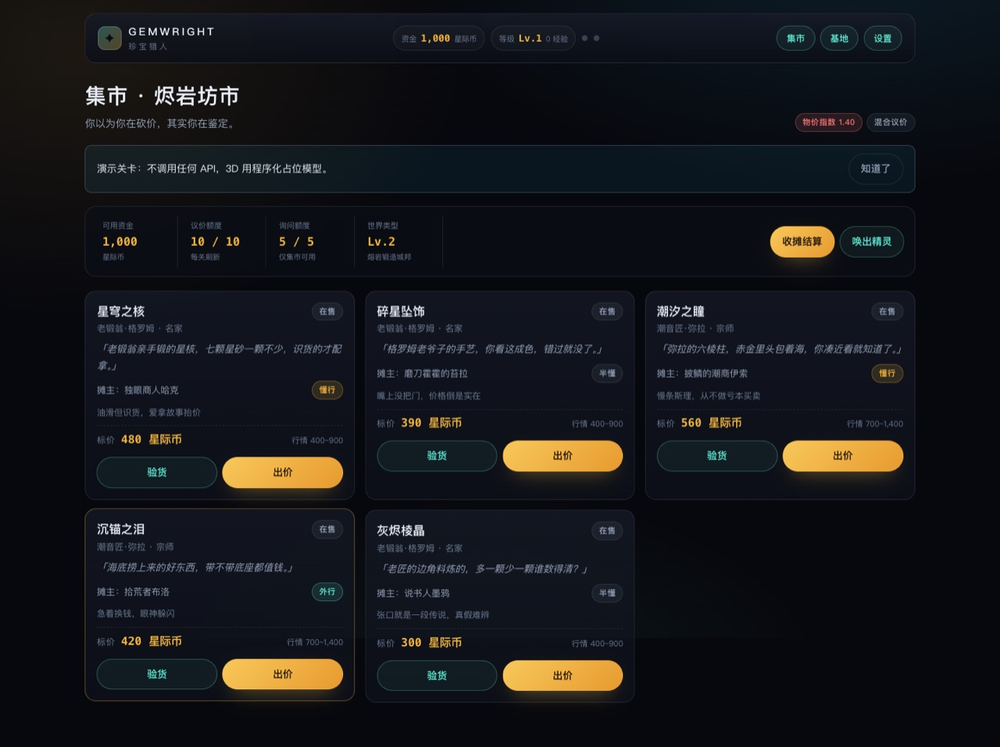
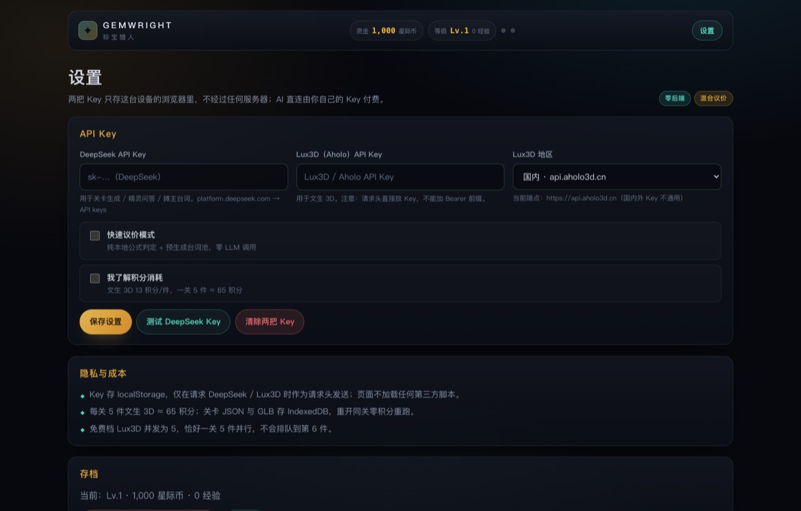
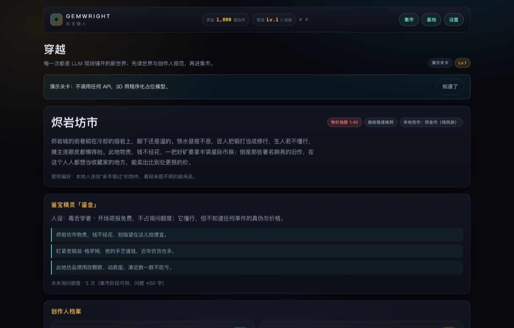
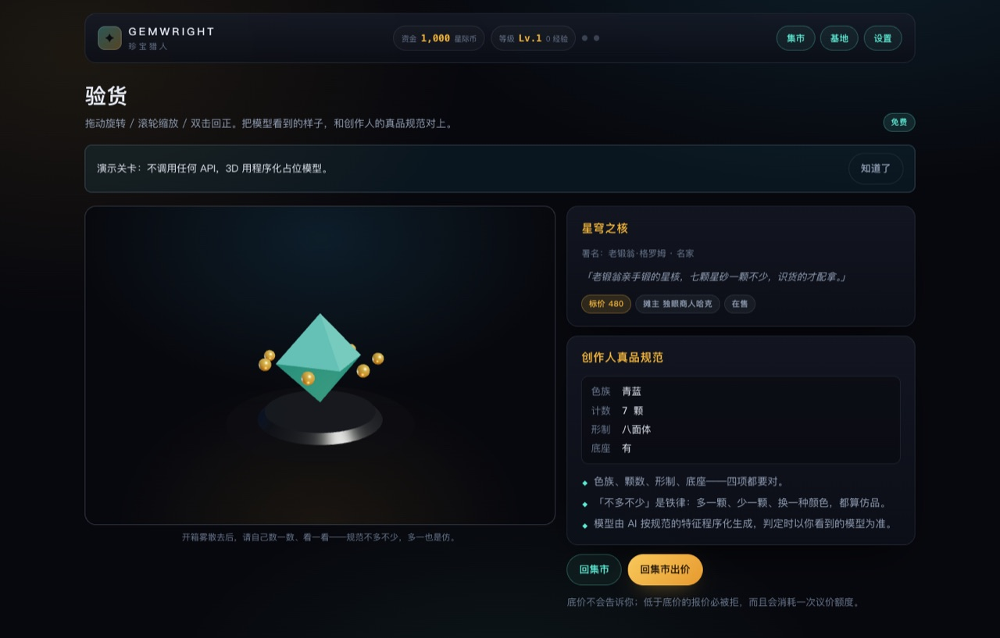
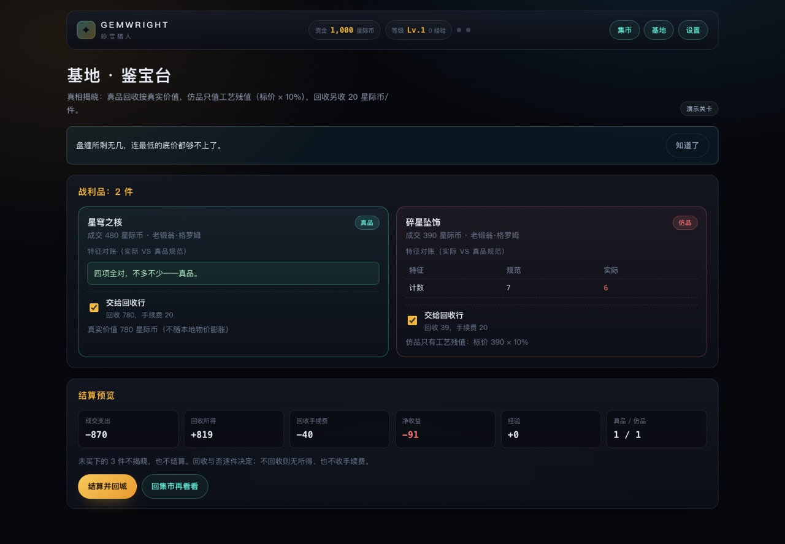

# Gemwright · 珍宝猎人

> 群核 Aholo 全球 3D AI 黑客松参赛项目 · 纯前端 MVP · 骨架已可运行

**带着一笔星际币穿越到 LLM 现场生成的异世界集市（该世界有自己的物价水平），在"高仿可能高价、珍品可能低价"的信息迷雾中砍价买下 5 件 3D 珍宝，回基地鉴宝回收——真伪由 Lux3D 生成的 3D 模型特征对照"创作人真品规范"来判定，赚差价升级出价与询问额度，再去更险更贵的世界。**

> **你以为你在砍价，其实你在鉴定。**

- 当前阶段：**D1 骨架完成**——5 屏流程、双 AI 适配层、判定/砍价/结算内核、3D 检视与缓存全部可跑；无 Key 也能用演示关卡走完整闭环。
- 权威方案：[docs/珍宝猎人-方案v8-MVP.md](docs/珍宝猎人-方案v8-MVP.md)（v8.1）
- 开发指南：[docs/开发指南.md](docs/开发指南.md)



## 目录

- [现在能玩到什么](#现在能玩到什么)
- [玩法闭环](#玩法闭环)
- [四个 AI 的分工](#四个-ai-的分工)
- [技术栈与取舍](#技术栈与取舍)
- [工程结构与模块地图](#工程结构与模块地图)
- [快速开始](#快速开始)
- [实现进度](#实现进度)
- [关键不变量](#关键不变量)
- [数值一览](#数值一览)
- [验证与测试](#验证与测试)
- [下一步](#下一步)
- [风险登记](#风险登记)

## 现在能玩到什么

**无需任何 Key（演示关卡，0 积分）**：设置页 → 去穿越 → 演示关卡 → 开市 → 拖动 3D 验货 → 问精灵 → 出价砍价 → 收摊 → 基地揭晓真伪 / 特征 diff → 逐件回收 → 结算。

演示关卡的 3D 模型是**程序化占位模型**：按 traits 渲染色族、颗数、形制、底座，因此"数一数、对一对规范"的判定玩法在无 Key 时也成立。

| 设置 | 穿越 | 验货 |
|---|---|---|
|  |  |  |

**填入两把 Key（真实链路）**：
- DeepSeek：整关 JSON / 精灵问答 / 摊主台词
- Lux3D（Aholo）：每件珍宝的文生 3D，`G1-Turbo`、13 积分/件、一关 5 件并发 ≈ 65 积分

## 玩法闭环

```
┌─ 集市阶段（每关） ─────────────────────────────────────────┐
│ ① 穿越   抽种子 → LLM 生成整关 JSON → 世界观 / 创作人规范 /  │
│          精灵三行简报（免费）        （3D 五件并行布展中）    │
│ ② 开市   5 件珍宝卡片（名称 / 署名 / 标价 / 摊主一句话）       │
│ ③ 验货   逐件 3D 检视：旋转 / 缩放 / 双击回正                 │
│          对照「创作人真品规范」核对色族·颗数·形制·底座        │
│ ④ 问精灵 5 次/关，问题 ≤50 字；懂行但不知价、不知真伪          │
│ ⑤ 议价   报价 → 摊主反应；额度 10 点/关，单件最多 4 回合      │
│ ⑥ 收摊   主动收摊 / 额度耗尽 / 资金低于最低底价（自动）        │
└────────────────────────────────────────────────────────────┘
┌─ 基地阶段 ─────────────────────────────────────────────────┐
│ ⑦ 鉴宝   逐件揭晓真伪 + 特征 diff 对账（免费）                 │
│ ⑧ 回收   逐件选择：付 20 手续费 → 拿回收价                    │
│ ⑨ 结算   净收益 = Σ回收 − Σ成交 − Σ手续费 → 经验 / 升级       │
│          议价额度 +5、询问额度 +2、难度 +1                    │
└────────────────────────────────────────────────────────────┘
```

## 四个 AI 的分工

| AI 环节 | 职责 | 玩法体现 |
|---|---|---|
| **DeepSeek**（玩家自配 Key） | 生成异世界、创作人、珍宝档案、价格、摊主人设 | 每局内容全新、无重复关卡 |
| **DeepSeek · 鉴宝精灵** | 持世界级知识答问（防火墙内） | 信息也是资源：问什么、何时问，是策略 |
| **Lux3D 文生 3D**（玩家自配 Key） | 按程序组装的 prompt 生成每件珍宝 GLB | 玩家亲手转动检视的就是 AI 生成物，判定依据藏在模型里 |
| **本地确定性代码** | 砍价数值判定、特征核对、收益结算 | 游戏永远公平、可复现、无随机翻脸 |

## 技术栈与取舍

| 层 | 选择 | 为什么 |
|---|---|---|
| 构建 | **Vite 8**（`base: './'`） | 秒级 HMR；产物是纯静态文件，可丢 GitHub Pages / OSS / 任意 CDN；无后端 |
| 语言 | **TypeScript 5.9（strict + noUncheckedIndexedAccess）** | 关卡 JSON 协议、价格 clamp、diff/结算最容易出静默错误，类型能拦掉一半 |
| UI | **无框架 + 原生 DOM**（`src/ui/dom.ts` 50 行 helper） | 方案明确"不上框架"；5 屏规模不需要 React 的运行时与心智负担 |
| 3D | **Three.js 0.187 + OrbitControls + GLTFLoader** | GLB 直接 `loader.parse`；单件按需加载，13MB/件不拖首屏 |
| 校验 | **Zod 4** | 手写 schema 替代方案里的"手写校验"，失败信息直接回灌给 LLM 做定向重试 |
| 存储 | **localStorage + IndexedDB** | Key / 存档走 localStorage；关卡 JSON 与 GLB blob 走 IndexedDB（URL 仅 2 小时有效，即下即存） |
| 测试 | **Vitest 5 + happy-dom** | 57 个单测覆盖判定 / 经济 / 防火墙 / 适配层 / 生成重试 / UI 冒烟 |
| 样式 | **原生 CSS + 设计 token** | 无 Tailwind 构建链；4 个 CSS 文件按 token/base/组件/屏幕分层 |

> 没有引入 ESLint / Prettier：骨架阶段用 `tsc --noEmit` + Vitest 守住质量，D3 前补上即可（见 [下一步](#下一步)）。

## 工程结构与模块地图

```
Gemwright/
├── index.html                    单页入口（首屏 + 5 屏挂载点）
├── package.json                  dev / build / test / verify 脚本
├── tsconfig.json                 strict 模式
├── vite.config.ts                base './'、静态构建
├── vitest.config.ts              happy-dom、tests/**/*.test.ts
├── public/favicon.svg
├── src/
│   ├── main.ts                   读设置 / 存档 → 挂载应用；DEV 暴露 window.gemwright
│   ├── app/
│   │   ├── store.ts              轻量可观察 store + 5 屏状态类型
│   │   ├── router.ts             状态路由；离开验货屏释放 WebGL
│   │   └── actions.ts            所有异步动作（生成 / 议价 / 问精灵 / 结算 / 存档）
│   ├── api/
│   │   ├── deepseek.ts           chat / jsonChat / 余额预检 / 超时与错误映射
│   │   ├── lux3d.ts              create → poll → download；国内 / 国际端点
│   │   └── types.ts              ChatClient 接口（逻辑层只依赖它，便于测试）
│   ├── config/
│   │   ├── constants.ts          数值表 / 额度 / 算子策略 / 色形白名单
│   │   └── prompts.ts            关卡 prompt / renderPrompt / 精灵 / 砍价 prompt
│   ├── game/
│   │   ├── level.ts              LevelSession 状态机（集市 → 基地 → 已结算）
│   │   ├── generation.ts         关卡生成（3 次定向重试）+ 5 件 3D 并发 + 缓存
│   │   ├── validate.ts           Zod schema + 归一化 + 真伪/特征程序覆写 + 价格重平衡
│   │   ├── economy.ts            资金 / 经验 / 等级 / 双额度 / 回收 / 结算 / 结束条件
│   │   ├── bargain.ts            硬规则 + 本地公式 + LLM 态度 + 一致性兜底
│   │   ├── fairy.ts              防火墙上下文 / 问题校验 / 回答过滤 / 调用
│   │   ├── seeds.ts              30 条异世界种子（各自物价指数区间）
│   │   ├── random.ts             mulberry32 / 洗牌（可复现）
│   │   └── fixtures/demoLevel.ts 演示关卡（与真实关卡同构，0 积分）
│   ├── render/viewer.ts          Three.js 单件检视：GLB + 占位模型 + 开箱雾
│   ├── store/
│   │   ├── cache.ts              IndexedDB（关卡 / GLB / 内存降级）+ 玩家存档
│   │   └── settings.ts           Key / 地区 / 快速议价（只存 localStorage）
│   ├── styles/                   tokens / base / components / screens
│   ├── types/level.ts            关卡协议 + 运行时 + 结算 + 错误类型
│   └── ui/
│       ├── dom.ts                h() / button() / toast()
│       ├── components.ts         顶栏 / 面板 / 徽章 / 特征表 / 布展进度
│       └── screens/              settings / travel / market / inspect / base
├── tests/                        10 个测试文件 / 57 个用例
└── docs/
    ├── 珍宝猎人-方案v8-MVP.md     权威方案 v8.1
    ├── 开发指南.md                模块职责、数据流、不变量、扩展方式
    └── screenshots/              UI 实拍（无 Key 演示关卡）
```

### 一次"穿越"的数据流

```
WorldSeed (seeds.ts)
  → buildLevelUserPrompt (config/prompts.ts)
  → DeepSeek jsonChat (api/deepseek.ts)               ── 失败 → 回灌 schema 问题，最多 3 次
  → normalizeLevel (game/validate.ts)                 ── Zod 校验 → 程序覆写真伪/特征/价格/难度
  → IndexedDB.saveLevel (store/cache.ts)
  → ensureLevelModels (game/generation.ts)            ── 5 件并行：renderPromptForTraits → Lux3D
  → TreasureViewer (render/viewer.ts)                 ── GLB 或 traits 占位模型
```

精灵问答的数据流刻意**断开**在关卡 JSON 之前：

```
LevelJson ──(只取 world / creators 公开档案 / 算子类型)──→ FairyContext → DeepSeek → filterAnswer
                     ✗ 不含 stalls（真伪 / 特征 / 任何价格）
```

## 快速开始

要求：Node ≥ 22。

```bash
npm install
npm run dev        # http://127.0.0.1:5173
npm run build      # 产物 dist/，相对路径，可直接静态托管
npm run test       # Vitest：57 个用例
npm run verify     # typecheck + test + build（提交前一键）
```

**操作路径（无 Key）**：设置 → 去穿越 → 演示关卡（0 积分）→ 开市 → 验货（拖动 / 滚轮 / 双击）→ 出价 → 收摊 → 结算。

**接入真实 AI**：
1. 设置页填 `DeepSeek API Key`（platform.deepseek.com）与 `Lux3D API Key`（labs.aholo3d.cn；国内外 Key 不通用，注意地区下拉）。
2. 点「测试 DeepSeek Key」做余额预检；保存设置。
3. 穿越页出现「穿越生成（≈65 积分）」。首关约 2~3 分钟：世界观先到先展，5 件 GLB 并行布展；重开同关零积分（IndexedDB）。

部署：`npm run build` 后把 `dist/` 丢到任意静态托管即可；Key 只在玩家浏览器里，不经任何服务器。

## 实现进度

| 方案模块 | 代码 | 状态 |
|---|---|---|
| 双 API 直连（CORS / 鉴权 / 轮询） | `src/api/*` | ✅ 适配层完成，按既有实测契约实现；**真实 Key 端到端待联调** |
| 关卡数据协议 + 归一化 | `src/game/validate.ts` | ✅ Zod、真伪覆写、特征推导、价格重平衡、难度整形 |
| 30 条世界种子 + 物价区间 | `src/game/seeds.ts` | ✅ |
| 生成编排（重试 / 并发 / 缓存） | `src/game/generation.ts` | ✅ 3 次定向重试；5 件并发；IndexedDB 缓存 |
| 鉴宝精灵（防火墙 / 额度 / 过滤） | `src/game/fairy.ts` | ✅ 物理隔离 + ≤50/≤100 字 + 编号过滤 |
| 混合砍价（硬规则 + LLM + 本地） | `src/game/bargain.ts` | ✅ 底价必拒、额度/回合、一致性兜底、断网降级 |
| 经济与结算 | `src/game/economy.ts` | ✅ 双额度、回收费、软重开、结束条件 |
| 3D 检视 | `src/render/viewer.ts` | ✅ GLB 解析 + 占位模型 + 雾淡入 + 释放 |
| IndexedDB / 存档 | `src/store/cache.ts` | ✅ 关卡 + GLB + 玩家存档；IndexedDB 不可用降级内存 |
| 5 屏 UI + 精灵抽屉 | `src/ui/screens/*` | ✅ 可完整走通；演出与动效属 D4 打磨 |
| 演出 / 音效 / 动画 | — | ⛔ 未做（D4） |
| 真实 Key 的 5×G1-Turbo 实跑 | — | ⛔ 待 D1 验收（需真实 Key） |
| 刷新后续玩当前关卡 | — | ⛔ 运行时状态未持久化（关卡 / 模型已缓存） |
| 移动端 / 多语言 | — | ⛔ 方案明确不做 |



## 关键不变量

这些是"玩法成立"的底线，改动前先看这里（细节见 [开发指南](docs/开发指南.md)）：

1. **真伪在生成时定死**：`isAuthentic ⇔ tamperOps.length === 0`，由 `normalizeLevel` 程序覆写；LLM 只提供素材，鉴宝只"揭晓"不改口。
2. **模型与判定同源**：`item.traits = applyTamperOps(creator.signatureTraits, tamperOps)`；`renderPromptForTraits(traits)` 用同一份 traits 组装 prompt，模型看到的就是判定依据。
3. **不多不少**：仿品 = 多一颗 / 少一颗 / 换色 / 换形 / 动底座；真品规范四项全对。特征只用粗粒度项（色族、计数 ≤7、形制、有无底座）。
4. **价格由前端持锁**：Σ标价 ∈ [1.5, 2.2]×资金、单件 ≤ 0.9×资金、底价 ∈ [55%, 75%] 标价、`trueValue` 锚定创作人 `quoteRange`（不乘物价指数）。
5. **难度整形**：L1 每件仿品 2 枚显性算子、L2 1 枚中等、L3+ 1 枚 `count ±1`；真品数 3 / 2 / 1。
6. **精灵物理隔离**：上下文只含 world、创作人公开档案（不含 `quoteRange`）、算子类型；stalls 根本不进 prompt；输出再过滤编号样式。
7. **砍价三道防线**：结构校验（额度 / 回合 / 资金）→ 低于底价必拒（不问 LLM）→ LLM 台词 + 一致性兜底；LLM 失败退回本地公式。
8. **额度即资源**：议价 10 点/关（+5/级）每次报价扣 1；询问 5 次/关（+2/级）仅集市可用；简报免费。
9. **缓存优先**：GLB URL 仅 2 小时有效，生成后立刻落 IndexedDB；重开同关零积分。
10. **Key 不上传**：只存 localStorage，仅作请求头发给 DeepSeek / Lux3D；页面无第三方脚本。

## 数值一览

| 项 | 值 |
|---|---|
| 初始资金 | 1000 星际币（软重开回 1000，保留等级） |
| 每关珍宝 | 5 件（真品 3 / 2 / 1 随难度递减） |
| 物价指数 | [0.8, 1.6] / 世界，只作用于标价与底价 |
| Σ 标价 | ∈ [1.5, 2.2] × 玩家资金；单件 ≤ 资金 × 0.9 |
| 议价额度 | 10 点 + 5/级，每关刷新，单件 ≤4 回合 |
| 询问额度 | 5 次 + 2/级，每关刷新，仅集市阶段，问 ≤50 字 / 答 ≤100 字 |
| 底价 | [0.55, 0.75] × 标价（前端持锁） |
| 回收 | 真品 = `trueValue`；仿品 = 0.1 × 标价；手续费 20/件 |
| 经验 / 难度 | 净收益即经验（负收益不给经验、不掉级），每 800 升 1 级；难度 = 等级 |
| 3D 消耗 | 13 积分/件 × 5 = 65/关；免费档并发 5 正好一关 |
| 结束条件 | 额度耗尽 / 资金 < 全场最低底价 / 无可议之货 |

## 验证与测试

```bash
npm run verify
# tsc --noEmit ✓
# vitest: 10 files / 57 tests ✓
# vite build: dist/ ✓（three 让主包 ~819KB，gzip ~220KB）
```

- 单测覆盖：价格 clamp、真伪覆写、难度整形、特征 diff、额度与回合、一致性兜底、结算数学、精灵防火墙、编号过滤、DeepSeek/Lux3D 请求契约、生成重试、5 件并发、UI 渲染、启动冒烟。
- 端到端：用本机 Chrome（Playwright 驱动）跑通「设置 → 穿越 → 集市 → 验货（WebGL canvas 渲染）→ 议价 → 自动收摊 → 基地 diff → 结算 → 下一关」，控制台 0 error；本文截图即该流程实拍。
- **未验证**：真实 DeepSeek / Lux3D Key 的在线调用（本轮无 Key）。适配层契约来自方案实测与既有项目实现，D1 需用真实 Key 复验。

## 下一步

| 优先级 | 事项 | 验收 |
|---|---|---|
| P0 | 真实 Key 跑通「LLM JSON → 5×G1-Turbo → GLB 落 IndexedDB」 | 控制台可见整关 JSON + 5 个有效 GLB |
| P0 | 用真实 GLB 核验计数特征保真度（样件 `crystal_test.glb`） | 7 颗 / 少 1 颗肉眼可辨；不稳则提高色族 / 形制权重 |
| P1 | 演出打磨：穿越、开箱雾、逐件揭晓、精灵打字机、摊主反应 | demo 视频可录 |
| P1 | 刷新续玩：把 `LevelRuntime` 一并持久化 | 中途刷新不丢进度、不重复计费 |
| P2 | Lux3D 失败重试 / 取消 / 内存释放；长任务可 abort | 单件失败可重试，不拖垮整关 |
| P2 | 补 ESLint + Prettier；Three.js 动态 import 拆包 | `npm run verify` 含 lint；首屏 < 200KB gzip |
| P3 | 部署公网静态站 + demo 脚本 | 评审可点开即玩 |

## 风险登记

| 风险 | 概率 | 影响 | 缓解 |
|---|---|---|---|
| 3D 计数特征渲染不准 | 中 | 玩家误判归因于游戏 | 特征白名单偏色 / 形；真实 Key 阶段先核验样件；揭晓页展示规范 diff |
| 精灵被间接套话 | 低 | 判定被抄近路 | 上下文物理隔离 + 角色挡回 + 编号过滤（已有单测） |
| LLM JSON 缺字段 / 越界 | 中 | 关卡生成失败 | Zod + 3 次定向重试 + 价格 clamp（已有单测） |
| 玩家 Key 无余额 / 欠费 | 中 | 首次体验失败 | 设置页余额预检 + 明示 65 积分消耗 |
| 真实 API 与适配层契约有出入 | 中 | D1 联调返工 | 适配层集中在 `src/api/`，改动面小；错误信息可读 |
| 主包偏大（three） | 低 | 首屏略慢 | D3 动态 import 拆 `viewer`；静态 gzip 220KB 可接受 |

---

- 方案：[docs/珍宝猎人-方案v8-MVP.md](docs/珍宝猎人-方案v8-MVP.md)
- 开发指南：[docs/开发指南.md](docs/开发指南.md)
- 群核 Aholo 全球 3D AI 黑客松 · 2026.11
